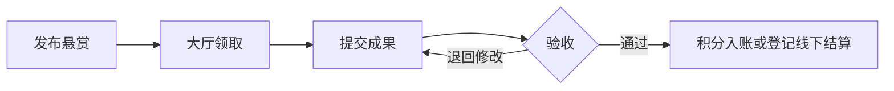

# 内部悬赏令

面向内部团队的中文工作悬赏平台。发布者写清任务和验收要求，成员在大厅认领工作并提交成果，发布者验收后发放奖励。适合整理资料、收集团队改进建议或协作完成项目复盘。

[流程展示](#流程展示) · [使用指南](#使用指南) · [在本机运行](#在本机运行) · [服务器部署](#linux服务器部署) · [操作规则](#操作规则)

## 流程展示



悬赏大厅支持按奖励类型、任务模式、标签和状态筛选，也可切换卡片与列表视图。想实际点一点页面，可以按[在本机运行](#在本机运行)的步骤启用演示数据。

## 使用指南

### 登录并找到操作入口

打开团队提供的站点地址，用管理员分配的内部账号登录。首次登录如提示修改密码，按页面要求设置新密码后重新登录。

| 入口 | 可以做什么 |
| --- | --- |
| **悬赏大厅** | 搜索任务，比较奖励、剩余名额和截止日期，打开卡片查看详情。 |
| **发布悬赏** | 填写工作要求和验收标准，设置奖励、参与模式、名额及截止日期，按需上传参考附件。 |
| **我的工作台** | 跟进「我承接的」「我发布的」和「待我验收」，查看积分余额、奖励明细及结算记录。 |
| **成员管理** | 管理员维护内部账号。 |

### 从发布到拿到奖励

1. **发布任务。** 在「发布悬赏」填写标题、工作说明和验收标准。选择「独立完成」时为每个名额设置奖励，由成员分别交付。选择「团队协作」时设置团队总奖励和人数上限，由团队共同交付。普通成员提交积分悬赏后需等管理员审核。管理员可直接发布积分或金额悬赏。
2. **承接任务。** 在「悬赏大厅」打开任务详情，确认工作要求、截止日期和剩余名额后领取。之后可以从「我的工作台 → 我承接的」回到任务。
3. **提交成果。** 在任务详情填写交付说明，按需附上成果文件并提交。团队任务由任一团队成员提交共同成果。收到退回反馈后，在同一任务里修改并重新提交。
4. **验收成果。** 发布者从「我的工作台 → 待我验收」进入任务，检查成果后通过或填写退回原因。团队成果通过时，验收人需要分配全体成员的奖励。
5. **查看奖励。** 通过验收后，积分自动入账，可在「我的奖励明细」查看。金额奖励在线下付款，付款后在「结算管理」登记。

例如，管理员可以发布一份「整理产品使用手册与常见问题」的独立悬赏，把验收标准写成「覆盖常见操作和已知问题」。领取人整理文档后在任务详情提交，发布者验收通过后，领取人就能在工作台看到奖励记录。

## 在本机运行

需要 Node.js 24 或更新的受支持版本。Windows、Linux、macOS 均可开发。依赖中的内嵌 PostgreSQL 仅用于本地开发与测试；生产数据库使用 Docker PostgreSQL。

```powershell
npm ci
npm run dev:local
```

打开 [http://localhost:3000](http://localhost:3000)。首次运行自动生成 `.env.local`，随机管理员账号信息保存在 `.data/初始管理员.txt`。首次登录必须修改密码。数据库和附件保存在 `.data/`，停止并重新启动后仍然保留。

需要本地示例任务时运行 `npm run dev:local -- --demo`。示例均带标识，演示账号保存在 `.data/演示账号.txt`。演示账号与示例数据不会自动创建到生产环境。

本地文件不得用于生产：`.env.local`、`.data/`、`node_modules/` 和 `.next/` 已从容器构建上下文排除。数据库中密码使用 scrypt 哈希，登录会话仅保存令牌哈希；本地初始密码文件仅用于首次交付，请妥善保管。

如果已有 PostgreSQL，配置 `.env.local` 中 `DATABASE_URL`、`APP_ORIGIN`、`COOKIE_SECURE`、`ADMIN_PASSWORD`，依次执行 `npm run db:migrate`、`npm run admin:init`、`npm run dev`。本地 `APP_ORIGIN` 默认是 `http://localhost:3000`，请使用完全相同的地址访问；使用 `127.0.0.1` 时需对应修改。

## Linux服务器部署

需要 Docker Engine 与 Compose 插件。将项目源码传到服务器，进入项目根目录，不要上传本地 `.env.local` 和 `.data`。

```sh
cp .env.example .env
# 编辑 .env：填入数据库随机密码、初始管理员密码、服务器访问地址。
docker compose up -d --build
docker compose ps
docker compose logs --tail=80 app cleanup
```

建议数据库密码使用24位以上随机字母数字，避免连接字符串中特殊字符的编码问题；管理员密码12至128位。`.env` 不要提交到版本库。首次启动完成迁移并创建管理员；再次启动保留现有账号和数据，不会重置密码。应用以非 root 用户运行。

暂用公网IP验收时，配置 `APP_ORIGIN=http://实际IP`、`SITE_ADDRESS=:80`、`COOKIE_SECURE=false`。在浏览器打开该IP登录。正式使用前按下节接入HTTPS，再传输内部工作材料。

只需对外开放80和443端口；数据库和应用端口均不对公网暴露。若服务器已有80/443端口服务，可将现有反向代理接到应用，并调整 Compose 的 Caddy 端口，保持 `APP_ORIGIN` 与外部访问地址一致。只有可信代理可以传入 `X-Real-IP`。

### 绑定域名与HTTPS

将域名的 A 记录指向服务器公网IP。若使用 AAAA 记录，也必须指向可访问的正确IPv6地址。保持80/443端口可达，然后修改服务器 `.env`：

```dotenv
APP_ORIGIN=https://bounty.example.com
SITE_ADDRESS=bounty.example.com
COOKIE_SECURE=true
```

```sh
docker compose up -d app caddy
```

Caddy 会为正确解析且可访问的域名申请、续期证书，并将HTTP跳转到HTTPS。证书保存在独立持久化卷中。[Caddy官方说明](https://caddyserver.com/docs/automatic-https)

## 操作规则

- 仅管理员可创建或删除账号。删除后账号从成员列表移除，登录会话立即失效，历史任务和奖励记录保留。管理员不能停用或删除当前账号。
- 普通成员只能提交积分悬赏。管理员审核任务内容与积分量，通过后才可领取。退回后可修改重提。管理员可直接发布积分或金额悬赏。发布者不能领取自己的任务。独立模式设置每人奖励与名额，团队模式设置总奖励和最多人数。
- 第一次被领取后，工作要求、奖励和模式锁定。首次提交前可退出并释放名额，领取每满24小时扣5积分。首次交付前逾期每满24小时扣10积分，逾期与退出扣分分别结算。逾期从截止、领取和钱包上线三者中最晚的时间起算，发布者设置截止时间后才会产生逾期扣分。
- 团队第一次提交锁定成员。任一团队成员可以提交共同成果，验收时由发布者分配总奖励。分配必须覆盖全员、非负且总额准确；允许某位成员获零奖励。
- 发布者或管理员可通过、退回修改，或处理异常任务。退回须填写原因，旧成果版本保留。管理员可从大厅进入任意任务处理。
- 工作台显示可用积分、预留积分和流水。每月按北京时间发放100积分，月初可用正余额计1%利息并向下取整。余额可为负，后续入账先补足欠额。发布时从钱包预留积分奖励，独立模式按每人奖励乘名额计算。验收通过后积分入账，退回审核、取消或提前结束时退回未发出的预留积分。旧任务不补扣发布积分，已有积分奖励转入钱包。
- 金额只登记奖励与线下付款。验收和发奖使用数据库事务，重复验收不会重复发放。
- 独立模式全部名额通过后自动完成；没有进行中成员时可提前结束。取消任务保留已获得的奖励，关闭其余工作。终止任务不重新开放。
- 发布时最多上传5个参考附件，合计不超过100MB，仅限ZIP、7Z、RAR。成果交付仍为每次最多5个、每个不超过20MB，支持JPG、PNG、WebP、PDF、DOCX、XLSX、PPTX、TXT、CSV、ZIP。附件不解压，下载时检查权限。
- 工作说明附件对已登录成员可见；交付附件只对发布者、对应参与者和管理员可见。任务结束15天后不可再下载，后台每小时清理到期文件；清理失败会重试，文件名称和过期记录继续保留。失败上传会回滚回收；进程中断留下的无引用临时文件超过24小时后对账回收，不影响任何有记录的正常附件。
- 大厅展示最新500份悬赏，个人奖励明细和结算管理分别展示各自最新1000条记录；累计奖励及首页概况使用独立全量统计，不受明细数量限制。适用于小规模内部团队，更大历史量可扩充分页。

## 备份、恢复和升级

Compose 为数据库、附件、Caddy证书和配置创建持久化卷。普通重启或重新构建不会清空数据。不要使用 `docker compose down -v`，该命令会移除持久化卷。

执行一致性备份时会短暂停止网站写入：

```sh
sh deploy/backup.sh
```

输出到 `backups/日期时间/`，包含数据库、附件和证书，服务在脚本结束时恢复。历史备份不自动删除。请把备份复制到其他机器，并单独安全保存 `.env`。备份包含内部数据及证书私钥，应限制访问。

推荐恢复到**新的项目目录和新的 Compose 项目名**，先验证再切换流量，避免覆盖当前数据。以下在新目录运行，先准备源码与生产 `.env`，将 `备份目录` 替换为实际绝对路径：

```sh
docker compose -p bounty-restore build app
docker compose -p bounty-restore up -d db
# 等待数据库健康后恢复，不在现有数据库上运行。
docker compose -p bounty-restore exec -T db pg_restore -U bounty -d bounty --no-owner < 备份目录/database.dump
docker compose -p bounty-restore run --rm --no-deps --entrypoint sh app -c 'mkdir -p /app/data/uploads && tar -xzf - -C /app/data' < 备份目录/uploads.tar.gz
# 可让 Caddy 根据域名重新签发证书；已有站点切换时先协调80/443端口。
docker compose -p bounty-restore up -d
```

需要保留证书时，可在新项目 Caddy 未运行前，使用其挂载的 `/data` 卷恢复 `caddy-data.tar.gz`。恢复后检查成员登录、悬赏数量、积分与结算记录，以及附件下载。旧备份中的附件若已经到期，会按相同保留规则清理。

升级前先备份，再更新源码并执行 `docker compose up -d --build`。迁移只执行一次并记录版本。若后续升级改变数据库结构，回退应使用与旧版本匹配的数据库备份；不能仅替换旧容器镜像。

## 开发验证

```sh
npm test
npm run typecheck
npm run build:scripts
npm run build
```

集成测试启动独立本机 PostgreSQL（55439端口），使用 `.data/test-postgres` 和 `.data/test-uploads`；不会连接本地开发或生产数据库。测试数据目录保留，不会自动删除项目文件。测试覆盖并发领取、奖励幂等、团队分配、权限、密码重置失效、附件到期边界和重试。

数据库/API实现采用参数化SQL和行锁。API写请求检查来源，登录执行账号/IP限流；前端不能代替后端权限检查。业务页按请求检查会话，附件响应禁用缓存。

已完成的真实验证及容器重现步骤见 [验收记录](docs/验收记录.md)。当前交付通过21项自动测试、58项HTTP检查和26项实际容器检查；公网服务器部署与真实域名HTTPS待提供服务器信息后进行。
