# CCP悬赏令

**把工作写下来，让本事有回报。**

面向内部团队的中文工作悬赏平台，串联任务发布、成员领取、成果交付、验收和奖励记录。支持单人承接与团队协作，适合资料整理、知识库建设、数据分析、代码开发和项目复盘。

界面采用纸张色调、朱红操作按钮和橄榄绿状态标记；工作台用可交互的藏宝箱呈现积分钱包。团队可以在一处看到工作要求、当前进度、历史成果和每一份付出的回报。

[功能一览](#功能一览) · [流程展示](#流程展示) · [网页截图](#网页截图) · [使用指南](#使用指南) · [在本机运行](#在本机运行) · [服务器部署](#linux服务器部署) · [操作规则](#操作规则)

## 功能一览

| 功能 | 已支持的能力 |
| --- | --- |
| 寻找悬赏 | 关键词搜索，按状态、奖励类型、协作方式和多个标签筛选；切换卡片或列表，按发布时间或奖励排序。 |
| 发布工作 | 明确标注必填项，分别填写工作说明与验收标准，关联已完成的悬赏，添加标签、截止时间和参考附件。 |
| 单人或团队协作 | 独立任务固定 1 人；团队可设置人数上限，共同提交成果，验收时分配总奖励。 |
| 控制领取范围 | 公开领取、推荐成员、指定成员；支持按姓名或账号搜索人选。 |
| 交付与验收 | 提交说明和成果附件，通过或退回修改，保留历史交付与验收意见。 |
| 积分与金额奖励 | 积分验收后自动入账，普通成员发布时预留积分；金额奖励记录待付款及线下结算情况。 |
| 个人工作台 | 集中查看承接、发布和待验收任务，以及可用积分、预留积分、累计奖励和明细。 |
| 团队积分榜 | 按验收获得的积分显示前 10 名，支持同分并列，第一名显示金色皇冠，每 10 秒更新。 |
| 管理员处理异常 | 填写原因后移除未完成的承接人，保留操作记录；符合补招条件的指定任务可补充人选。 |
| 成员与账号 | 审核注册申请和成员发布的悬赏，管理账号与角色；成员可更换头像、修改密码。 |
| 私有部署 | PostgreSQL 保存业务数据，附件按权限下载，支持 Docker Compose、HTTPS、持久化及备份恢复。 |


## 流程展示

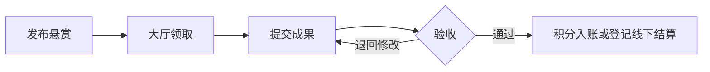

## 网页展示

### 一、悬赏大厅

进入大厅即可查看未完成悬赏、已完成悬赏、待验收数量和个人累计积分，右侧积分榜则展示前 10 名。

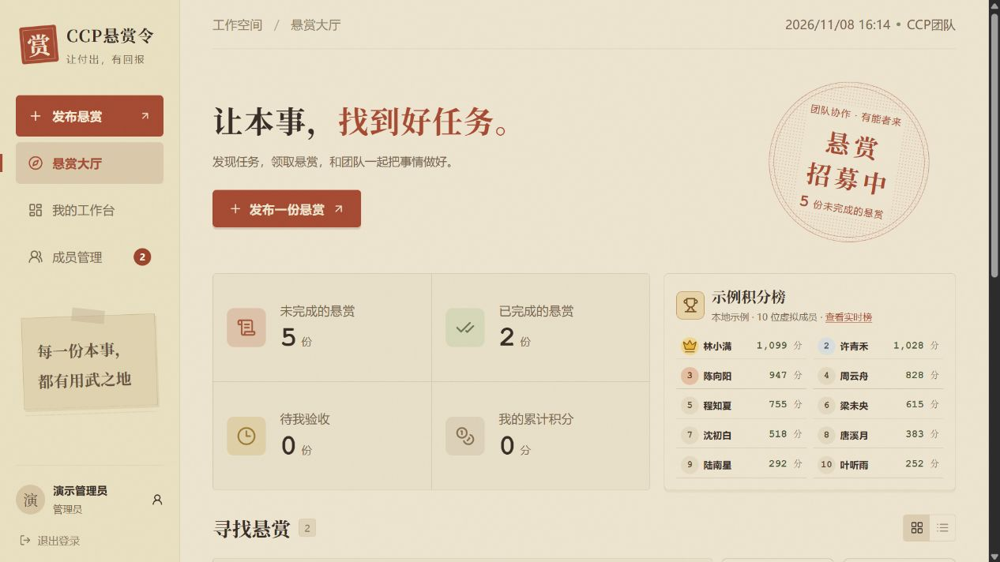

「全部悬赏」位于状态筛选最前面。未领满显示「待领取」，领满且尚未完成显示「进行中」。

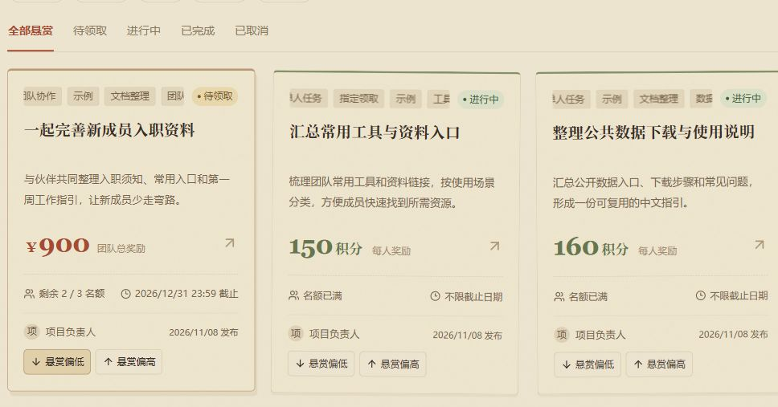

### 二、我的工作台

积分钱包区分可用与预留积分，下方汇总累计奖励和待验收交付。继续向下可切换「我承接的」「我发布的」「待我验收」、奖励明细与结算管理。

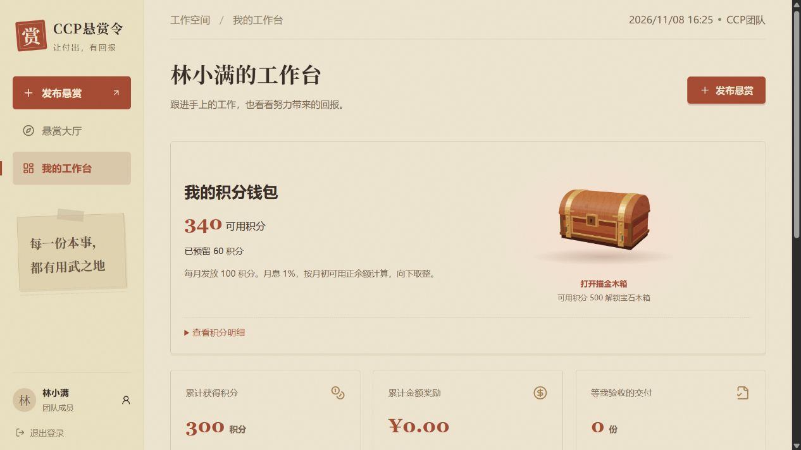

### 三、更多功能

<details>
<summary><strong>1. 登录与注册：内部账号、注册申请</strong></summary>

新成员可在同一页面申请注册，等待管理员审核。使用初始密码首次登录后，需要按提示修改密码。

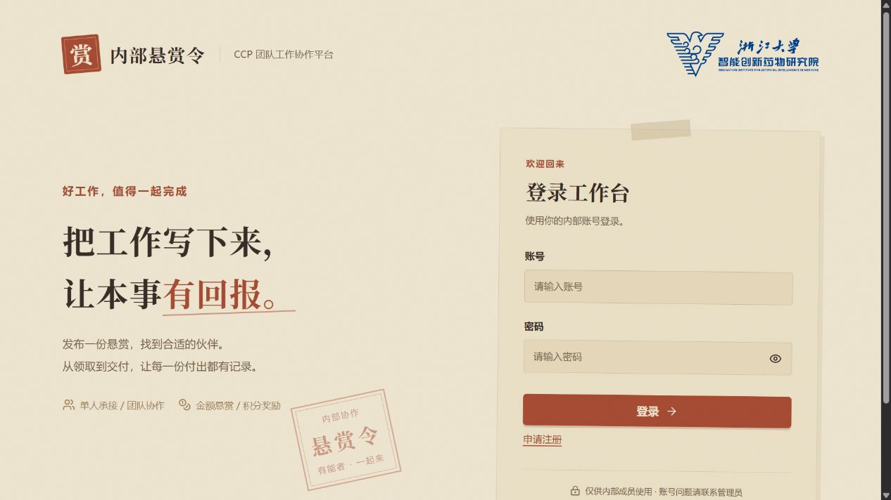

</details>

<details>
<summary><strong>2. 发布悬赏：历史参考、团队人数、截止时间与指定领取</strong></summary>

**关联历史成果。** 可搜索已完成的悬赏，最多关联 5 项，便于领取人理解背景并复用已有工作。

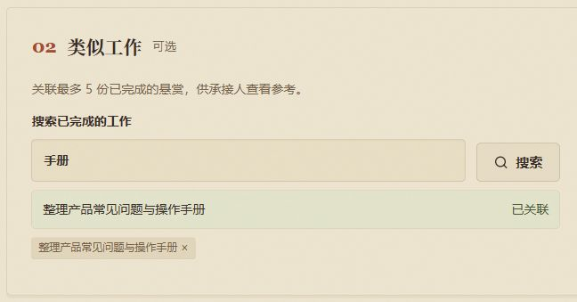

**选择协作方式。** 独立任务固定 1 人，无需填写名额；团队任务默认 2 人，可设置人数上限。

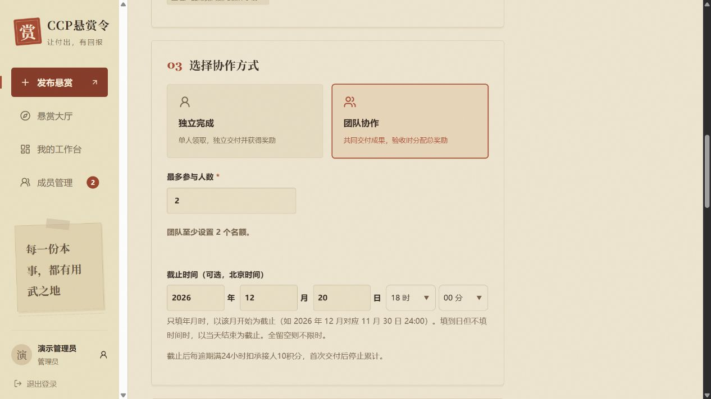

**决定谁可以领取。** 推荐名单不限制其他合适成员领取；指定模式只允许名单内的成员领取。人选可按姓名或账号搜索并多选，团队人数上限单独设置。

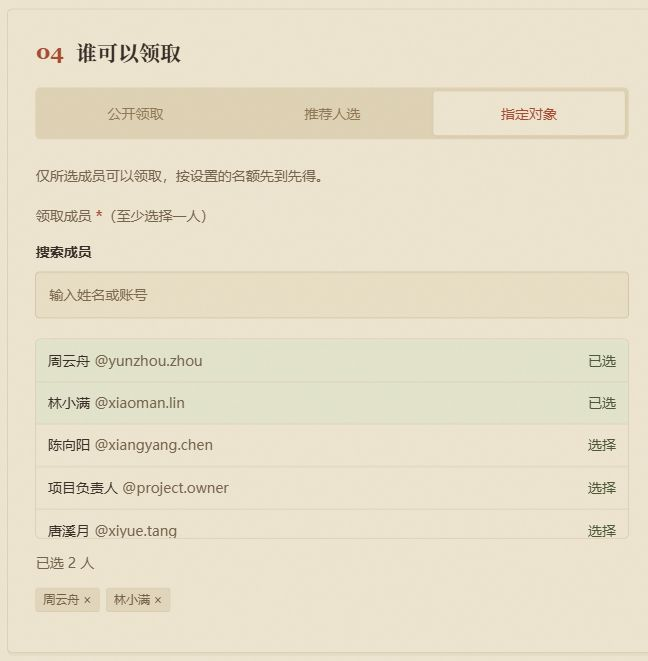

</details>

<details>
<summary><strong>团队验收：填写意见、分配总奖励</strong></summary>

发布者或管理员检查团队共同成果后，可以通过或退回。通过时为当前有效成员分配奖励，各项非负且合计等于团队总奖励，允许某位成员分得 0。

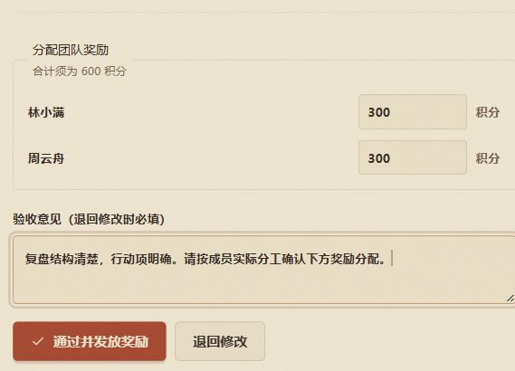

</details>

<details>
<summary><strong>管理员操作：审核、移除原因与指定补位</strong></summary>

**统一处理审核。** 侧栏显示注册申请和悬赏发布的待审核总数，进入成员管理后分别处理。

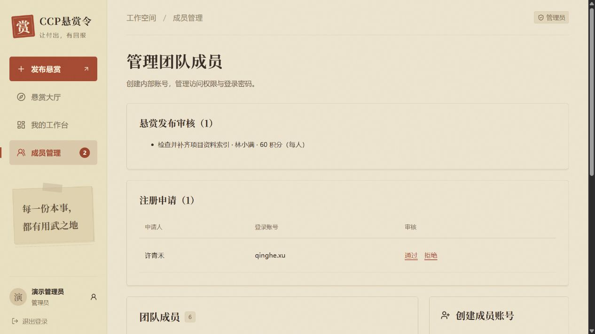

**移除不合适的承接人。** 管理员必须填写原因，确认框说明名额、成果和积分的处理方式。移除不新增扣分，已产生的扣分保留，被移除者不能重领同一任务。

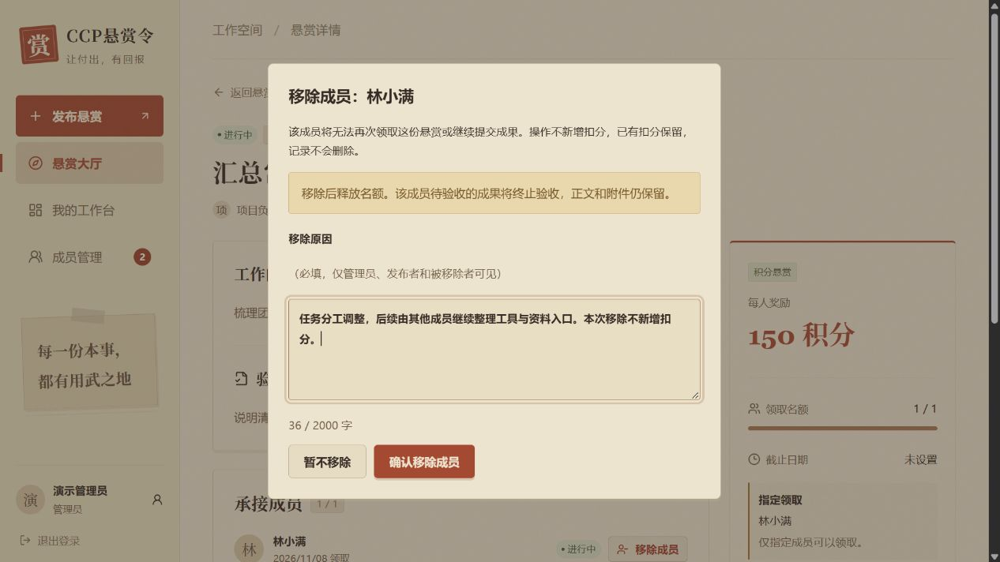

**保留记录并补充指定人选。** 原因、操作人和时间仅管理员、发布者及被移除本人可见。符合补招条件时，管理员可追加启用中的指定成员，保留原名单与审计记录。

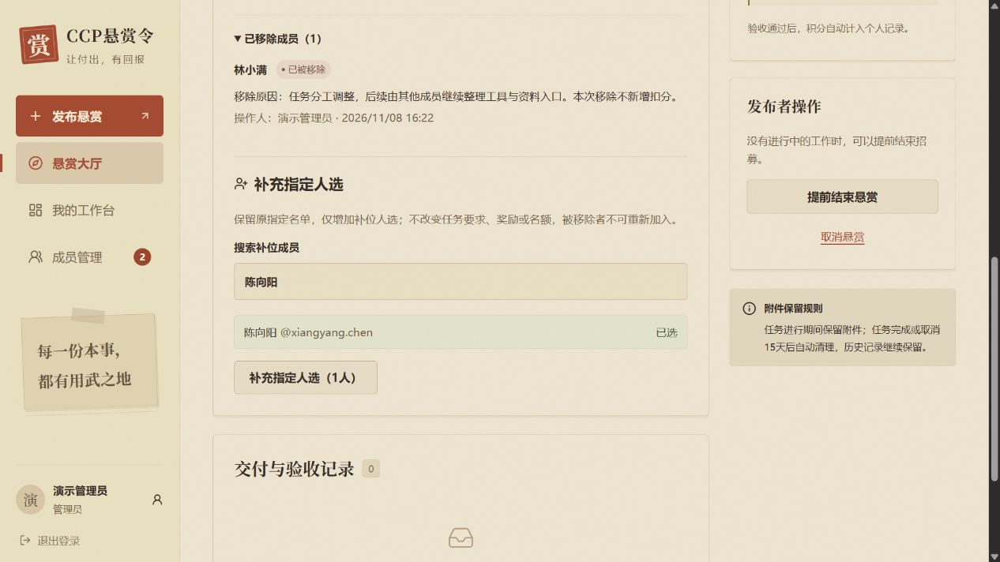

完整的名额、团队成果及附件处理规则见[管理员移除承接人](#管理员移除承接人)。

</details>

<details>
<summary><strong>账号设置：更换头像与修改密码</strong></summary>

头像支持 JPG、PNG、WebP，最大 5MB。修改密码后，原有登录会话全部失效。

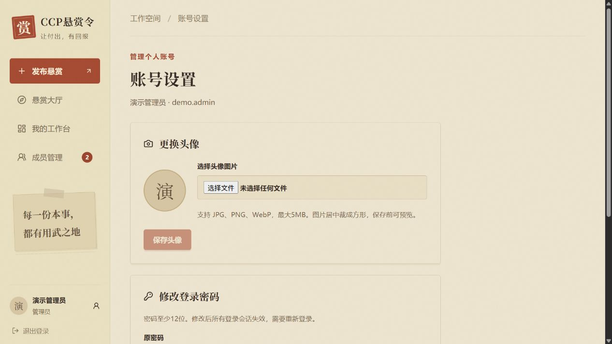

</details>

## 使用指南

### 登录并找到操作入口

打开团队提供的站点地址，用内部账号登录。还没有账号时可点「申请注册」，管理员审核通过后即可登录。使用管理员分配的初始密码首次登录时，按提示修改密码后重新登录。

| 入口 | 可以做什么 |
| --- | --- |
| **悬赏大厅** | 搜索和筛选任务，切换卡片或列表，查看前 10 名积分榜。标签可以多选，任务匹配任一所选标签即可显示。 |
| **发布悬赏** | 填写工作要求和验收标准，设置协作方式、领取对象、名额、奖励和标签，按需填写截止时间或上传附件。 |
| **我的工作台** | 跟进「我承接的」「我发布的」和「待我验收」，查看积分余额、奖励明细及结算记录。 |
| **成员管理** | 管理员审核注册申请和成员悬赏，创建账号并调整成员角色。 |

### 角色与权限

| 身份 | 发布与领取 | 验收与管理 |
| --- | --- | --- |
| 普通成员 | 可发布积分悬赏，审核通过后开放领取；可承接符合领取条件的他人任务。 | 验收自己发布的任务，查看自己的奖励、交付和附件。 |
| 管理员 | 可直接发布积分或金额悬赏；平台出资的积分悬赏不占个人钱包。 | 可处理任意发布者任务的验收，审核申请、管理成员、移除符合条件的承接人和补充指定人选。 |

「发布者」指创建该任务的人。普通发布者可以验收自己任务的成果，移除承接人仍须由管理员操作；任何人都不能领取自己发布的任务。

### 如何理解任务状态

| 状态 | 含义 |
| --- | --- |
| 待领取 | 还没有人领取，或当前有效承接人数未达到人数上限。 |
| 进行中 | 名额已满，任务尚未完成。 |
| 已完成 | 已通过验收完成，或由发布者按规则提前结束招募。 |
| 已取消 | 任务已取消，已获得的奖励及历史记录保留。 |

大厅默认展示「待领取」；概况里的「未完成的悬赏」为待领取与进行中的总数。退出或被管理员移除释放名额后，状态按剩余有效人数重新计算。团队已经交付后的成员锁定和补招规则仍按下文执行，不能仅凭「待领取」判断是否可以加入。

### 从发布到拿到奖励

1. **发布任务。** 填写标题、工作说明和验收标准。独立任务固定为单人领取，无需填写名额；团队任务默认2人，人数上限至少为2，设置总奖励后共同交付。可搜索已完成悬赏并关联为参考，标签可直接点选或新建。截止时间按北京时间分栏填写。全留空表示不限时，只填年月则以该月开始为截止，例如 2026 年 12 月对应 11 月 30 日 24:00。填写年月日但不填时间，则在当天结束时截止。
2. **承接任务。** 在大厅打开详情，确认工作要求、截止时间和剩余名额后领取。被指定的成员会看到「指定给我」。领取后可从「我的工作台 → 我承接的」回到任务。
3. **提交成果。** 在任务详情填写交付说明，按需附上成果文件并提交。团队任务由任一团队成员提交共同成果。收到退回反馈后，在同一任务里修改并重新提交。
4. **验收成果。** 发布者从「我的工作台 → 待我验收」进入任务，检查成果后通过或填写退回原因。团队成果通过时，验收人需要为当前有效成员分配奖励。
5. **查看奖励。** 通过验收后，积分自动入账，可在「我的奖励明细」查看。金额奖励在线下付款，付款后在「结算管理」登记。

例如，管理员可以发布一份「整理产品使用手册与常见问题」的独立悬赏，把验收标准写成「覆盖常见操作和已知问题」。领取人整理文档后在任务详情提交，发布者验收通过后，领取人就能在工作台看到奖励记录。

## 在本机运行

需要 Node.js 24 或更新的受支持版本。Windows、Linux、macOS 均可开发。依赖中的内嵌 PostgreSQL 仅用于本地开发与测试；生产数据库使用 Docker PostgreSQL。

```powershell
npm ci
npm run dev:local
```

打开 [http://127.0.0.1:3000](http://127.0.0.1:3000)。首次运行自动生成 `.env.local`，随机管理员账号信息保存在 `.data/初始管理员.txt`。首次登录必须修改密码。数据库和附件保存在 `.data/`，停止并重新启动后仍然保留。

需要本地示例任务时运行 `npm run dev:local -- --demo`。示例均带标识，演示账号保存在 `.data/演示账号.txt`。演示账号与示例数据不会自动创建到生产环境。

如需预览截图里的十名榜单，在启动本地服务前设置环境变量 `BOUNTY_LOCAL_LEADERBOARD_PREVIEW=1`，登录后访问 `/tasks?leaderboard=demo`。页面会生成十名虚拟成员的积分，点击「查看实时榜」即可返回。预览数据无需写入数据库。

本地文件不得用于生产：`.env.local`、`.data/`、`node_modules/` 和 `.next/` 已从容器构建上下文排除。数据库中密码使用 scrypt 哈希，登录会话仅保存令牌哈希；本地初始密码文件仅用于首次交付，请妥善保管。

如果已有 PostgreSQL，配置 `.env.local` 中 `DATABASE_URL`、`APP_ORIGIN`、`COOKIE_SECURE`、`ADMIN_PASSWORD`，依次执行 `npm run db:migrate`、`npm run admin:init`、`npm run dev`。请使用与 `APP_ORIGIN` 完全一致的地址访问。

## Linux服务器部署

需要 Docker Engine 与 Compose 插件。预构建镜像 [`bingshaowei0404/ccp-reword:1.0.0`](https://hub.docker.com/r/bingshaowei0404/ccp-reword/tags?name=1.0.0) 支持 `linux/amd64`，可直接从 Docker Hub 拉取。

在服务器的部署目录中准备 `compose.yaml`、`.env.example` 和 `deploy/Caddyfile`，保留原有目录结构。首次部署时，从模板创建 `.env` 并填写数据库随机密码、初始管理员密码和服务器访问地址。

```sh
cp .env.example .env
# 编辑 .env 后继续。
docker pull bingshaowei0404/ccp-reword:1.0.0
docker tag bingshaowei0404/ccp-reword:1.0.0 internal-bounty:local
docker compose up -d --no-build
docker compose ps
docker compose logs --tail=80 app cleanup
```

`app` 和 `cleanup` 共用 `internal-bounty:local`，Compose 会另外启动 PostgreSQL 和 Caddy。如需从源码构建，请在完整的项目目录中执行 `docker compose up -d --build`。

建议数据库密码使用24位以上随机字母数字，避免连接字符串中特殊字符的编码问题；管理员密码12至128位。`.env` 不要提交到版本库。首次启动完成迁移并创建管理员；再次启动保留现有账号和数据，不会重置密码。应用以非 root 用户运行。

暂用公网IP验收时，配置 `APP_ORIGIN=http://实际IP`、`SITE_ADDRESS=:80`、`COOKIE_SECURE=false`。在浏览器打开该IP登录。正式使用前按下节接入HTTPS，再传输内部工作材料。

只需对外开放80和443端口；数据库和应用端口均不对公网暴露。若服务器已有80/443端口服务，可将现有反向代理接到应用，并调整 Compose 的 Caddy 端口，保持 `APP_ORIGIN` 与外部访问地址一致。只有可信代理可以传入 `X-Real-IP`。

### 绑定域名与HTTPS

将域名的 A 记录指向服务器公网IP。若使用 AAAA 记录，也必须指向可访问的正确IPv6地址。保持80/443端口可达，然后修改服务器 `.env`：

```dotenv
APP_ORIGIN=https://bounty.example.com
SITE_ADDRESS=bounty.example.com
COOKIE_SECURE=true
```

```sh
docker compose up -d app caddy
```

Caddy 会为正确解析且可访问的域名申请、续期证书，并将HTTP跳转到HTTPS。证书保存在独立持久化卷中。[Caddy官方说明](https://caddyserver.com/docs/automatic-https)

## 操作规则

- 管理员可创建、停用或删除账号，也可升降成员角色。角色变更、停用或删除会使原会话失效。删除账号后保留历史任务和奖励记录。管理员不能停用、删除或降级自己的账号。
- 普通成员只能提交积分悬赏。管理员审核任务内容与积分量，通过后才可领取。退回后可修改重提。管理员可直接发布积分或金额悬赏。发布者不能领取自己的任务。发布独立任务时固定为1个名额，团队模式设置总奖励和最多人数（至少2人）。
- 领取方式分为公开、推荐和指定。推荐名单会在详情页显示，所有符合条件的成员仍可领取。指定任务只允许名单内的成员领取，名额最多等于指定人数，先到先得。指定名单由发布者和管理员查看。
- 大厅允许成员给待领取或进行中的悬赏点选「悬赏偏低」或「悬赏偏高」。每人每项一票，可改选或撤回。发布者可查看汇总。
- 左侧「成员管理」显示待审核的悬赏和注册申请总数，进入后可分别处理。管理员可以删除已完成的悬赏，奖励、结算和积分流水继续保留。
- 第一次被领取后，工作要求、奖励、协作方式和领取对象锁定。首次提交前可退出并释放名额，领取每满24小时扣5积分。首次交付前逾期每满24小时扣10积分，逾期与退出扣分分别结算。逾期从截止、领取和钱包上线三者中最晚的时间起算，发布者设置截止时间后才会产生逾期扣分。
- 团队第一次提交锁定成员。任一团队成员可以提交共同成果，验收时由发布者分配总奖励。分配必须覆盖当前有效成员、非负且总额准确；允许某位成员获零奖励。管理员移除成员后的补招和成果规则见下节。
- 发布者或管理员可通过、退回修改，或处理异常任务。退回须填写原因，旧成果版本保留。管理员可从大厅进入任意任务处理。
- 工作台显示可用积分、预留积分和流水。每月按北京时间发放 100 积分，月初可用正余额计 1% 利息并向下取整。余额可为负，后续入账先补足欠额。普通成员发布时从钱包预留积分，独立模式按每人奖励乘名额计算。验收通过后积分入账，审核退回、取消或提前结束时退回未发出的预留积分。
- 管理员的工作台显示「无限积分」。管理员发布的积分悬赏由平台出资，验收后按约定给承接人发放积分。已有钱包流水继续保留，降级为普通成员后恢复显示实际余额。
- 实时积分榜按悬赏验收实际获得的积分排名，最多显示 10 位成员。同分并列，页面开启时每 10 秒更新。
- 金额只登记奖励与线下付款。验收和发奖使用数据库事务，重复验收不会重复发放。
- 独立模式全部名额通过后自动完成；没有进行中成员时可提前结束。取消任务保留已获得的奖励，关闭其余工作。终止任务不重新开放。
- 发布时最多上传5个参考附件，合计不超过100MB，仅限ZIP、7Z、RAR。成果交付仍为每次最多5个、每个不超过20MB，支持JPG、PNG、WebP、PDF、DOCX、XLSX、PPTX、TXT、CSV、ZIP。附件不解压，下载时检查权限。
- 工作说明附件对已登录成员可见；交付附件只对发布者、对应参与者和管理员可见。任务结束15天后不可再下载，后台每小时清理到期文件；清理失败会重试，文件名称和过期记录继续保留。失败上传会回滚回收；进程中断留下的无引用临时文件超过24小时后对账回收，不影响任何有记录的正常附件。
- 大厅展示最新500份悬赏，个人奖励明细和结算管理分别展示各自最新1000条记录；累计奖励及首页概况使用独立全量统计，不受明细数量限制。适用于小规模内部团队，更大历史量可扩充分页。

## 管理员移除承接人

管理员可以在任务详情的承接成员旁点击「移除成员」，填写1至2000字的具体原因并确认。仅处理进行中、待验收或待修改的承接记录；已通过验收、已结束的任务不能移除。普通发布者没有该权限。

移除不会新增退出或逾期扣分，已有扣分保留；该成员不能再次领取同一任务。操作人、时间及原因只对管理员、发布者和被移除者显示，成员可在工作台和详情查看自身状态及原因。

独立任务释放名额，原待验收交付终止验收并保留记录。团队尚未交付时可以补招；已交付且仍有成员时，保留成果和成员锁定，由剩余成员继续验收、分配原总奖励。全员被移除时，原待验收成果终止验收，解除锁定供新团队领取并重新交付。被移除者保留本人上传的成果和附件，但不能再查看其他成员的团队成果。

指定领取任务有移除空缺且未锁定时，管理员可在详情补充启用中的指定成员；原名单保留、总名单最多100人，被移除者不可重新加入。不自动改为公开领取，也不改变工作要求、奖励、截止时间和人数上限。移除与补位均保留审计记录。

## 备份、恢复和升级

Compose 为数据库、附件、Caddy证书和配置创建持久化卷。普通重启或重新构建不会清空数据。不要使用 `docker compose down -v`，该命令会移除持久化卷。

执行一致性备份时会短暂停止网站写入：

```sh
sh deploy/backup.sh
```

输出到 `backups/日期时间/`，包含数据库、附件和证书，服务在脚本结束时恢复。历史备份不自动删除。请把备份复制到其他机器，并单独安全保存 `.env`。备份包含内部数据及证书私钥，应限制访问。

推荐恢复到**新的项目目录和新的 Compose 项目名**，先验证再切换流量，避免覆盖当前数据。以下在新目录运行，先准备源码与生产 `.env`，将 `备份目录` 替换为实际绝对路径：

```sh
docker compose -p bounty-restore build app
docker compose -p bounty-restore up -d db
# 等待数据库健康后恢复，不在现有数据库上运行。
docker compose -p bounty-restore exec -T db pg_restore -U bounty -d bounty --no-owner < 备份目录/database.dump
docker compose -p bounty-restore run --rm --no-deps --entrypoint sh app -c 'mkdir -p /app/data/uploads && tar -xzf - -C /app/data' < 备份目录/uploads.tar.gz
# 可让 Caddy 根据域名重新签发证书；已有站点切换时先协调80/443端口。
docker compose -p bounty-restore up -d
```

需要保留证书时，可在新项目 Caddy 未运行前，使用其挂载的 `/data` 卷恢复 `caddy-data.tar.gz`。恢复后检查成员登录、悬赏数量、积分与结算记录，以及附件下载。旧备份中的附件若已经到期，会按相同保留规则清理。

升级前先备份。使用 Docker Hub 镜像部署时，保留现有 `.env` 和数据卷，拉取目标版本，将它标记为 `internal-bounty:local`，再执行 `docker compose up -d --no-build`。使用源码部署时，更新源码后执行 `docker compose up -d --build`。迁移只执行一次并记录版本。若后续升级改变数据库结构，回退应使用与旧版本匹配的数据库备份；不能仅替换旧容器镜像。

## 开发验证

技术栈：Next.js 16、React 19、TypeScript、PostgreSQL；生产部署使用 Docker Compose 与 Caddy。

```sh
npm test
npm run typecheck
npm run build:scripts
npm run build
```

集成测试启动独立本机 PostgreSQL（55439端口），使用 `.data/test-postgres` 和 `.data/test-uploads`；不会连接本地开发或生产数据库。测试数据目录保留，不会自动删除项目文件。测试覆盖并发领取、奖励幂等、团队分配、管理员移除与验收并发、原因隐私、指定补位、历史成果和附件权限、密码重置失效、附件到期边界和重试。

数据库/API实现采用参数化SQL和行锁。API写请求检查来源，登录执行账号/IP限流；前端不能代替后端权限检查。业务页按请求检查会话，附件响应禁用缓存。

初版的 HTTP 与容器验收记录见 [验收记录](docs/验收记录.md)。新版已通过自动化测试、类型检查及 Linux 容器构建，并在线上验证了 HTTPS 登录页、标识加载和未登录访问保护。
